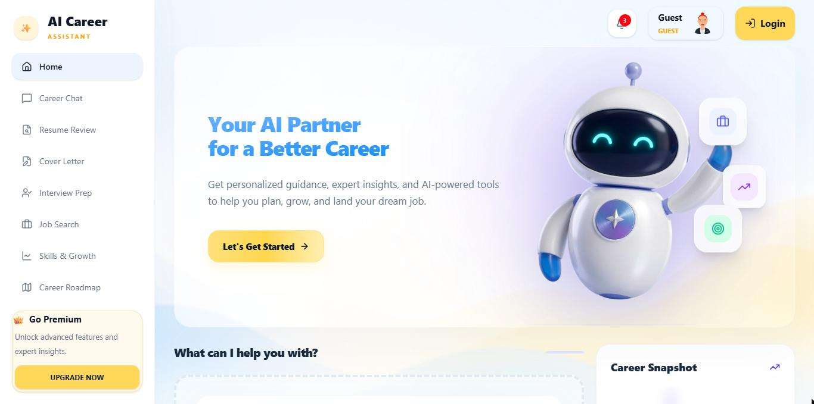
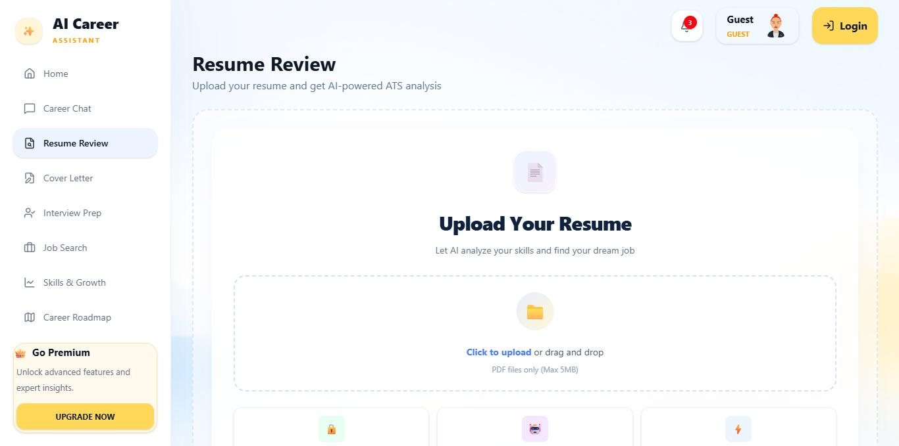
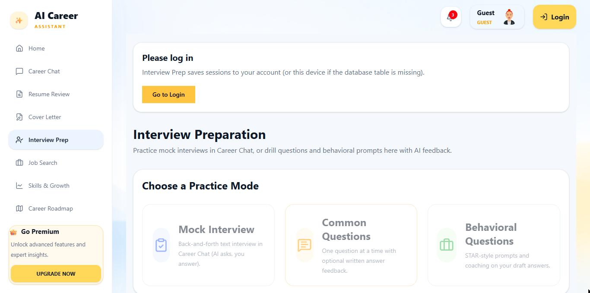

# AI Career Assistant

An AI-powered career platform: upload your résumé, get an ATS-style review, chat with a career
coach that knows your résumé, practise interviews by voice, and generate roadmaps and cover letters.

**Live:** https://ai-career-assistant-1-9nbp.onrender.com
<sub>(free hosting — the first visit can take ~50 seconds to wake up)</sub>



## Features

| Area | What it does |
|---|---|
| **Résumé review** | Upload a PDF; text is extracted (pdfplumber / PyPDF2) and scored with an ATS-style check, with strengths and gaps. |
| **Career chat** | Chat with an LLM coach (Groq · Llama 3.1 8B) that receives your stored résumé as context and answers about roles, skills and next steps. Chat history is saved in Supabase. |
| **Voice assistant** | Real-time voice conversation over WebSockets, with spoken replies via Edge TTS. |
| **Interview prep** | Generates role-specific interview questions and practice sessions. |
| **Career roadmap & skills growth** | Step-by-step learning roadmaps and skill recommendations for a target role. |
| **Cover letters** | Drafts a cover letter from your résumé and a job description. |
| **Job search** | Searches the web (DuckDuckGo) for openings matching your profile. |
| **Accounts** | Sign-up / login with Supabase Auth; saved items per user. |

## Architecture

```
Next.js 16 (React 19, TypeScript, Tailwind)  ──►  FastAPI backend (Python)
        │  app/ pages + app/api routes              ├─ routes: resume, chat, voice (WebSocket), image, web_search
        │                                            ├─ services: résumé parser, LLM client, voice
        └──────────────► Supabase (Postgres + Auth) ◄┘   tables: profiles, résumés, cover_letters, interview_sessions
                                    LLM: Groq API (Llama 3.1)
```

`backend/app/services/embedding.py` and `matching.py` contain an embedding-based retrieval module
(OpenAI `text-embedding-3-small` + a Supabase vector-match function). It is not yet wired into the
chat routes; today the chat passes the stored résumé text directly as context.

## Tech stack

**Frontend:** Next.js 16 · React 19 · TypeScript · Tailwind CSS · react-markdown
**Backend:** Python · FastAPI · Uvicorn · WebSockets · pdfplumber · Edge TTS
**Data & AI:** Supabase (Postgres, Auth) · Groq API (Llama 3.1) · OpenAI embeddings (retrieval module)

## Run locally

**Backend**

```bash
cd backend
python -m venv .venv && source .venv/bin/activate   # Windows: .venv\Scripts\activate
pip install -r requirements.txt
# create backend/.env with: SUPABASE_URL, SUPABASE_KEY, GROQ_API_KEY (and OPENAI_API_KEY for the retrieval module)
uvicorn app.main:app --reload --port 8001
```

**Frontend**

```bash
cd frontend
npm install
# create frontend/.env.local with: NEXT_PUBLIC_SUPABASE_URL, NEXT_PUBLIC_SUPABASE_ANON_KEY, GROQ_API_KEY, NEXT_PUBLIC_API_URL=http://127.0.0.1:8001
npm run dev        # http://localhost:3000
```

**Database:** run the SQL files in `supabase/sql/` in your Supabase project.

## Screens

| | |
|---|---|
|  |  |

## Author

**Naina Shukla** · [GitHub](https://github.com/Naina7120284) · [LinkedIn](https://www.linkedin.com/in/naina-shukla-15406a260/)
